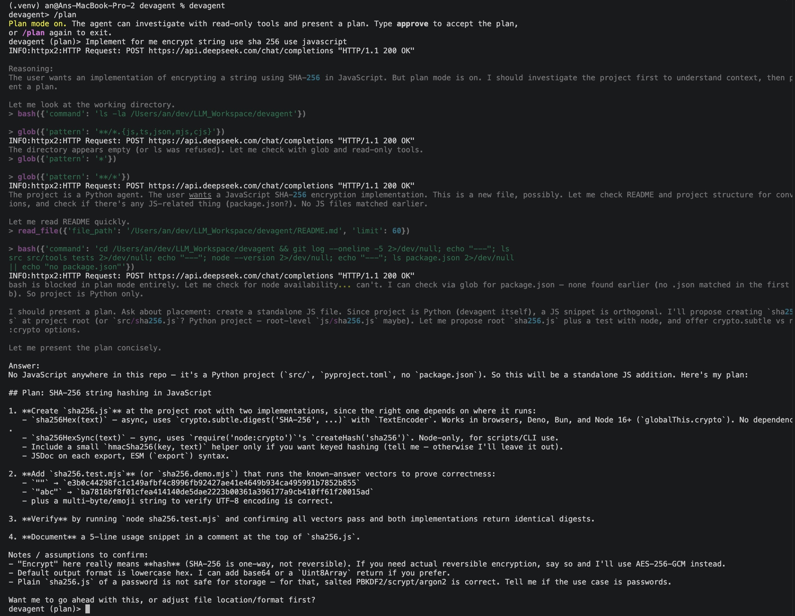

# devagent

devagent is a small, interactive coding agent that runs in your terminal. It uses an LLM to understand software engineering requests, inspect a project, and use local development tools to help complete tasks.



*devagent investigating a coding task in read-only plan mode.*

## What it does

- Answers questions about a codebase using file and content search.
- Reads, creates, and edits files.
- Runs shell commands with user approval.
- Tracks multi-step work with a session checklist.
- Delegates independent tasks to sub-agents.
- Runs multiple tool calls concurrently when the model requests them together.
- Streams model responses and compresses older conversation context when needed.

Tools that can change files or run commands request approval. Use `/plan` to investigate a task in read-only mode, or `--yes` to automatically approve tool calls.

## How it works

1. The CLI sends the conversation and available tool definitions to the configured LLM.
2. The agent handles the streamed response. If the model requests tools, devagent runs them and returns their results to the model.
3. The agent repeats this cycle until it has a response for the user.

The code is organized around the agent loop, an LLM client, a permission handler, and a collection of tools in `src/tools/`.

## Tech stack

- **Python 3.11+** — application and agent implementation
- **OpenAI Python SDK** — streaming chat completions and tool calling with OpenAI-compatible APIs
- **Rich** — terminal output
- **prompt_toolkit** — interactive permission prompts
- **python-dotenv** — load configuration from a local `.env` file
- **Hatchling** — package and build configuration
- **Ruff** — optional linting and development dependency

## Getting started

Requirements: Python 3.11 or newer and an API key for your chosen model provider.

```sh
python -m venv .venv
source .venv/bin/activate
pip install -e .
```

Create a `.env` file in the project root and set your provider credentials:

```dotenv
OPENAI_API_KEY=your-api-key
OPENAI_BASE_URL=https://api.deepseek.com
MODEL=deepseek-v4-flash
```

Start the interactive CLI:

```sh
python -m src
```

After installation, you can also run:

```sh
devagent
```

To automatically approve tool calls:

```sh
devagent --yes
```

## Configuration

Configuration is read from environment variables and the project’s `.env` file.

| Variable | Purpose | Default |
| --- | --- | --- |
| `OPENAI_API_KEY` | API key for the configured provider | Required |
| `OPENAI_BASE_URL` | OpenAI-compatible API endpoint | DeepSeek API |
| `MODEL` | Model name | `deepseek-v4-flash` |
| `MAX_TOKENS` | Maximum response tokens | `4096` |
| `TEMPERATURE` | Response temperature | `0` |
| `MAX_CONTEXT_TOKENS` | Conversation context limit | `128000` |
| `LOG_LEVEL` | Application log level | `INFO` |

## Development

Run the test suite with Python’s built-in unittest runner:

```sh
python -m unittest discover -s tests
```
